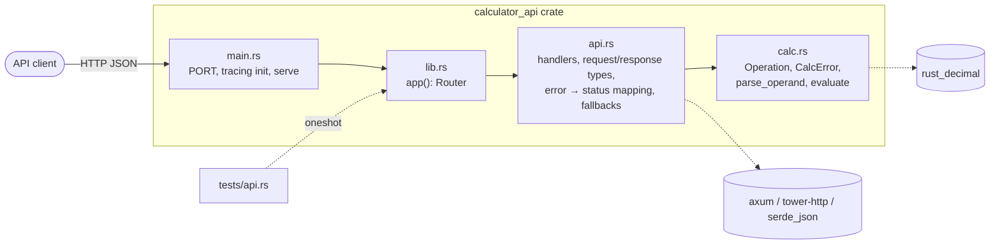
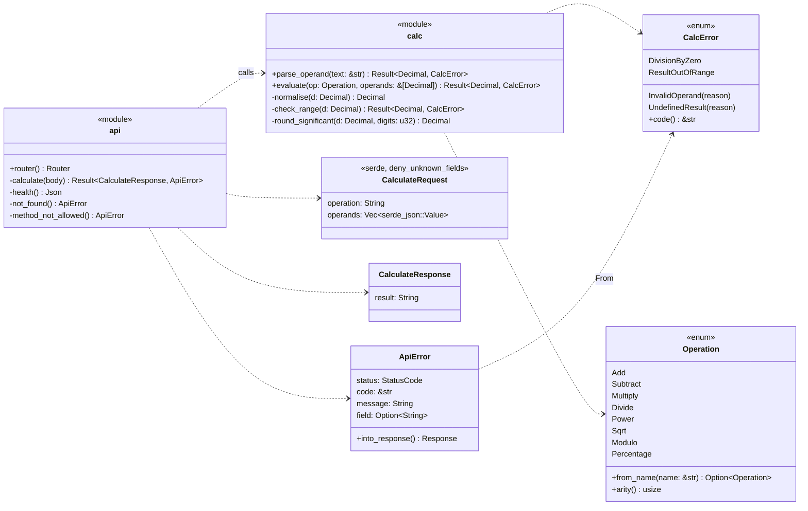
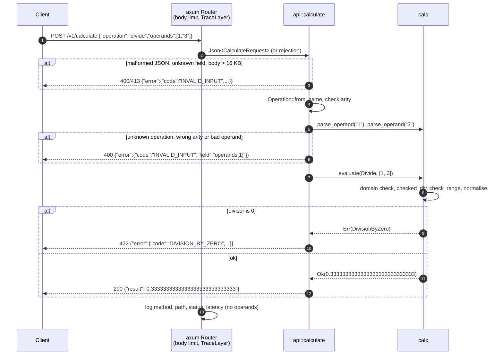

# Implementation plan: Calculator API

Status: Accepted (Serban, PR #4) · Date: 2026-11-07
Inputs: [PRD](../prd/PRD.md) (Accepted, with A1) · [ADR-0001 – 0005](../adr/README.md) (Accepted)
Tasks: [TASKS.md](TASKS.md)

## 1. Approach

Build inside out, test first (superpowers `test-driven-development`,
`implement-task` skill):

1. **Walking skeleton**: crates from the ADRs, library/binary split, `GET /health`
   served by `app()` and covered by an in-process API test.
2. **Domain (`calc`)**: pure functions for parsing operands and evaluating
   each operation, with the ADR-0003 rules. Unit tests from the PRD examples,
   then property tests.
3. **HTTP (`api`)**: `POST /v1/calculate`, request validation, error mapping,
   body limit, JSON fallbacks.
4. **Operations**: logging, OpenAPI contract, smoke test and run instructions.

Each task ends green on `cargo fmt --check`, `cargo clippy -- -D warnings`,
`cargo test`, and is one commit.

## 2. Components

Dependencies point one way: `main` → `api` → `calc` → `rust_decimal`.
`calc` knows nothing about HTTP or JSON (ADR-0004).

## 3. Types

`CalcError` → `ApiError` mapping (ADR-0002):

| `CalcError` | `code` | Status |
|-------------|--------|--------|
| `InvalidOperand` (plus api-side shape errors) | `INVALID_INPUT` | 400 (413 for body limit) |
| `DivisionByZero` | `DIVISION_BY_ZERO` | 422 |
| `UndefinedResult` | `UNDEFINED_RESULT` | 422 |
| `ResultOutOfRange` | `RESULT_OUT_OF_RANGE` | 422 |

## 4. Request flow

Happy path and the two kinds of failure: an input error stopped in `api`, and
a maths error raised by `calc`.

## 5. Evaluation rules per operation

From ADR-0003; each row is a unit-test group.

| Operation | Domain checks before computing | Computation | After |
|-----------|-------------------------------|-------------|-------|
| add, subtract, multiply | — | `checked_add/sub/mul` | range, normalise |
| divide | `b == 0` → `DivisionByZero` | `checked_div` | range, normalise |
| modulo | `b == 0` → `DivisionByZero` | `checked_rem` (sign of `a`) | range, normalise |
| percentage | — | `checked_mul(a, b) / 100`; on overflow `(a / 100) × b` | range, normalise |
| sqrt | `a < 0` → `UndefinedResult` | `sqrt` | round to 20 significant digits, normalise |
| power | `a == 0 && b < 0` → `UndefinedResult`; `a < 0 && b` not integer → `UndefinedResult` | `checked_powd`; if `b < 0` and it fails, check `a^|b|` overflows → `0` | integer `b`: range, normalise; otherwise round to 20 significant digits, normalise |

"range" = magnitude < 10^28 else `ResultOutOfRange`; "normalise" = strip
trailing zeros, `-0` → `0`.

## 6. Risks

| Risk | Mitigation |
|------|------------|
| `serde_json` `arbitrary_precision` changes number handling crate-wide | Only `api` touches `serde_json::Value`; operand text goes straight to `parse_operand` |
| axum rejections come back as plain text | Handler takes `Result<Json<_>, JsonRejection>` and maps every rejection; fallbacks for 404/405; API tests assert JSON bodies |
| `rust_decimal` `powd` precision varies with inputs | 20-digit rounding; property test compares `x^0.5` with `sqrt(x)` |
| Hand-written OpenAPI drifts from code | API tests use the contract's request/response examples (T-11) |
| Timebox | Tasks ordered by priority; `Could` items (FR-8) and polish last |

## 7. Definition of done

- Every task in TASKS.md ticked, each with its own commit.
- `cargo fmt --check`, `cargo clippy -- -D warnings`, `cargo test` green.
- Every PRD acceptance example appears in a test (coverage table in TASKS.md).
- Smoke test with `curl` against `cargo run` recorded in T-12.
