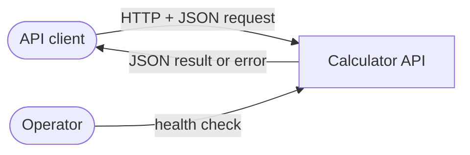

# PRD: Calculator API

Status: **Accepted** (Serban, PR #1, 2026-11-07) · Amendment A1 proposed (ADR-0003, PR #2) · Owner: Serban

## 1. Problem and goal

Client applications need a small, reliable service that performs arithmetic
and reports errors in a predictable, machine-readable way. The goal is a
stateless HTTP JSON API that does a well-defined set of calculations correctly,
rejects bad input clearly, and never returns a silently wrong number.

A secondary goal: the service is the subject of a spec-driven development
exercise, so every behaviour here must be specific enough to test.

## 2. Users and use cases

| Actor | Use case |
|-------|----------|
| API client (another service, script or developer with `curl`) | Send two numbers and an operation, get the result back |
| API client | Get a clear error when input is invalid or the operation is undefined |
| Operator | Check that the service is up |

## 3. Scope

The system boundary is one stateless HTTP service. It receives a request,
computes, and answers. It stores nothing and calls no other system.

### In scope

- Arithmetic on real numbers: add, subtract, multiply, divide, power, square
  root, modulo, percentage.
- Input validation and a consistent error format.
- A health check.
- Machine-readable API documentation of the endpoints.

### Out of scope (and why)

| Item | Why |
|------|-----|
| Parsing expressions like `2 + 3 * 4` | Needs a grammar and parser; doubles the work and risk for little extra value in the timebox |
| History, memory, persistence | Keeps the service stateless; no storage to design or secure |
| Authentication, users, rate limiting | Belongs to an API gateway in front of the service, not to the calculator |
| Unlimited precision or big numbers | Results are exact decimals up to 28 significant digits with magnitude below 10^28 (NFR-3); more is not needed for a calculator |
| Complex numbers, trigonometry, logarithms, units, currency | Not requested; can be added later as new FRs |
| Batch or chained operations in one request | One request = one operation keeps the contract simple |
| User interface | API only |

## 4. Functional requirements

All operations take decimal numbers as input and return a single decimal
number, following the numeric rules in NFR-3. "Error" means the error
response from section 6.

| ID | Requirement | Acceptance criteria | Priority |
|----|-------------|---------------------|----------|
| FR-1 | Add two numbers `a + b` | `2, 3` → `5`; `-1.5, 0.5` → `-1`; `0.1, 0.2` → `0.3` exactly | Must |
| FR-2 | Subtract `a - b` | `5, 3` → `2`; `3, 5` → `-2` | Must |
| FR-3 | Multiply `a × b` | `4, 2.5` → `10`; `-3, 0` → `0` (see FR-13) | Must |
| FR-4 | Divide `a ÷ b` | `10, 4` → `2.5`; `1, 3` → `0.3333333333333333333333333333` (28 decimal places); `1, 0` → error `DIVISION_BY_ZERO` | Must |
| FR-5 | Power `a ^ b` | `2, 10` → `1024`; `4, 0.5` → `2`; `2, -1` → `0.5`; `0, 0` → `1` (Q-6); `2, -100` → `0` (below 28 decimal places); `0, -1` → error `UNDEFINED_RESULT`; `-8, 0.5` → error `UNDEFINED_RESULT` (not a real number) | Should |
| FR-6 | Square root `√a` (one operand) | `9` → `3`; `0.25` → `0.5`; `2` → `1.4142135623730950488` (20 significant digits); `-1` → error `UNDEFINED_RESULT` | Should |
| FR-7 | Modulo: remainder of `a ÷ b`, sign follows the dividend `a` (Q-3) | `10, 3` → `1`; `-10, 3` → `-1`; `5.5, 2` → `1.5`; `1, 0` → error `DIVISION_BY_ZERO` | Should |
| FR-8 | Percentage: `a` percent of `b`, i.e. `a × b ÷ 100` | `20, 50` → `10`; `150, 40` → `60` | Could |
| FR-9 | Reject invalid input | Missing operand, extra unknown fields, non-numeric operand, operand with magnitude ≥ 10^28 or more than 28 decimal places (e.g. `1e400`, `1e-40`), wrong operand count for the operation, malformed JSON, unknown operation → error `INVALID_INPUT` naming the problem field | Must |
| FR-10 | Never return an out-of-range number | Any result with magnitude ≥ 10^28 (e.g. `1e20 × 1e10`, `10 ^ 30`) → error `RESULT_OUT_OF_RANGE` instead | Must |
| FR-11 | Health check | A health endpoint responds with a success status and a body reporting `ok`, without doing a calculation | Must |
| FR-12 | API documentation | Every endpoint, request and response shape, including errors, is described in a machine-readable contract kept in the repo | Should |
| FR-13 | Never return negative zero (Q-4) | A result of `-0` is returned as `0`: `-3, 0` multiply → `0`; `0, -5` divide → `0` | Should |

## 5. Non-functional requirements

| ID | Requirement | Measure |
|----|-------------|---------|
| NFR-1 | Stateless | No data survives a request; any instance can serve any request |
| NFR-2 | Fast | p99 under 10 ms per request on a developer laptop, excluding network |
| NFR-3 | Exact decimal numerics (Q-1) | Inputs are read as exact decimals (`0.1` is exactly one tenth, never a binary approximation). Results are exact when they fit in 28 decimal places; otherwise rounded half-to-even to 28 decimal places (`1 ÷ 300` → `0.0033333333333333333333333333`). Results of `√` and non-integer powers are rounded half-to-even to 20 significant digits, all of them correct (`4 ^ 0.5` → `2`). Results carry no trailing zeros (`0.50` → `0.5`). Supported magnitude is below 10^28. Responses must carry the result to clients without losing digits |
| NFR-4 | Robust | No input, however malformed or large, crashes the service or returns a server error |
| NFR-5 | Bounded input | Request bodies over 16 KB are rejected with `INVALID_INPUT` |
| NFR-6 | Easy to run | One command builds, one command tests, one command starts the service |
| NFR-7 | Observable | Each request logs the operation, outcome and duration; operands are not logged |

## 6. Error behaviour

Every error has the same JSON shape: a stable machine-readable `code`, a
human-readable `message`, and, for input errors, the `field` at fault. The
exact HTTP status mapping and body layout are decided in an ADR.

| Code | When | Category |
|------|------|----------|
| `INVALID_INPUT` | Bad request shape, types, operand count, unknown operation, oversized body (FR-9, NFR-5) | Client error |
| `DIVISION_BY_ZERO` | Divide or modulo by zero (FR-4, FR-7) | Client error |
| `UNDEFINED_RESULT` | Mathematically undefined in real numbers: `√` of a negative, `0 ^ negative`, negative base with fractional exponent (FR-5, FR-6) | Client error |
| `RESULT_OUT_OF_RANGE` | Result magnitude is 10^28 or more (FR-10) | Client error |

No input causes a server error (NFR-4).

## 7. Open questions and assumptions

| ID | Question | Current assumption | Status |
|----|----------|--------------------|--------|
| Q-1 | Must `0.1 + 0.2` return exactly `0.3` (decimal arithmetic)? | Yes: exact decimal arithmetic, rules in NFR-3 | Answered by Serban, 2026-11-07 |
| Q-2 | Which operations are in scope? | Core four plus power, square root, modulo, percentage; no expression parsing | Answered by Serban, 2026-11-07 |
| Q-3 | Modulo sign convention for negatives? | Sign follows the dividend: `-10 mod 3 = -1` (FR-7) | Answered by Serban, 2026-11-07 |
| Q-4 | Is `-0` a valid result to return? | No: normalise to `0` (FR-13) | Answered by Serban, 2026-11-07 |
| Q-5 | Auth and rate limiting? | Out of scope, handled by a gateway | Assumed |
| Q-6 | What is `0 ^ 0`? | `1`, the convention in most languages and IEEE-754 `pow` | Open, part of A1 |

## 8. Glossary

- **Operand**: an input number (`a`, `b`).
- **Significant digits**: the digits of a number from its first non-zero digit; `0.00123` has 3.
- **Half-to-even rounding**: rounding a tie to the nearest even digit (`2.5 → 2`, `3.5 → 4`), which avoids drift across many operations.
- **Error code**: the stable identifier in an error response that clients match on.

## 9. Change log

| ID | Date | Change | Why | Status |
|----|------|--------|-----|--------|
| A1 | 2026-11-07 | NFR-3, FR-4, FR-5, FR-6, FR-9, Q-6: precision is 28 decimal places (not 28 significant digits); `√` and fractional powers give 20 significant digits; no trailing zeros; `0 ^ 0 = 1`; tiny powers round to `0` | The ADR-0003 spike showed the decimal library's limit and that fractional powers are approximate (`4 ^ 0.5` = `2.0000000000000000000000000003`) | Proposed, needs Serban's acceptance |
